# Instituto Mão Amiga — Plataforma Full-Stack

**API Spring Boot + Aplicativo Mobile/Web**

Sistema de gestão de pontos de coleta e distribuição e de registro de doações do **Instituto Mão Amiga**, desenvolvido com arquitetura cliente-servidor. O backend fornece uma API RESTful em Java com Spring Boot e persistência em arquivo H2, enquanto o frontend mobile/web é construído em React Native (Expo + TypeScript).

---

## Sumário

- [Estrutura do repositório](#estrutura-do-repositório)
- [Como executar o projeto](#como-executar-o-projeto)
  - [Pré-requisitos](#1-pré-requisitos)
  - [Backend — API Spring Boot](#2-rodando-a-api-backend-spring-boot)
  - [Frontend — React Native e Expo](#3-rodando-o-aplicativo-frontend-react-native--expo)
- [Documentação dos endpoints e evidências do Swagger](#documentação-dos-endpoints-e-evidências-do-swagger)
  - [Módulo 1 — Pontos de coleta e distribuição](#módulo-1--pontos-de-coleta-e-distribuição)
  - [Paginação e busca de pontos](#paginação-e-busca-de-pontos-n2-2)
  - [Módulo 2 — Doações](#módulo-2--doações)
- [Roteiro de demonstração](#roteiro-de-demonstração-até-3-minutos)
- [Decisão técnica e arquitetural](#decisão-técnica-e-arquitetural)

---

## Estrutura do Repositório

- **`/backend`** (ou **`/api`**): API RESTful desenvolvida em Java com Spring Boot, Spring Data JPA, Bean Validation, H2 Database (persistência em arquivo) e documentação interativa OpenAPI/Swagger.
- **`/frontend`**: aplicativo mobile/web em React Native (Expo), com tipagem estrita em TypeScript, paginação infinita (`FlatList`), integração HTTP centralizada (`src/services/api.ts`) e armazenamento local (`AsyncStorage`) para favoritos.

---

## Como Executar o Projeto

### 1. Pré-requisitos

- **Java (JDK):** versão **21** (compatível com JDK 17+).
- **Node.js:** versão **20 LTS** ou superior.
- **Gerenciador de pacotes:** `npm` (incluso no Node.js).

### 2. Rodando a API (Backend Spring Boot)

1. Acesse a pasta da API no terminal:

   ```bash
   cd backend
   ```

2. Execute a aplicação utilizando o Maven Wrapper.

   **Windows (CMD/PowerShell):**

   ```powershell
   .\mvnw.cmd spring-boot:run
   ```

   **Linux / macOS:**

   ```bash
   ./mvnw spring-boot:run
   ```

A API iniciará na porta **8080** (`http://localhost:8080`). Na primeira inicialização, o banco H2 em arquivo (`./data/maoamigadb`) será criado e populado automaticamente com mais de 25 pontos de coleta/distribuição em Goiânia, sem duplicação nos reinícios seguintes.

**Swagger UI:** acesse [`http://localhost:8080/swagger-ui.html`](http://localhost:8080/swagger-ui.html) no navegador.

### 3. Rodando o Aplicativo (Frontend React Native / Expo)

1. Acesse a pasta do aplicativo e instale as dependências:

   ```bash
   cd frontend
   npm install
   ```

2. Configure o IP da API no arquivo `.env`.

   Por segurança e boas práticas de versionamento, o arquivo `.env` está listado no `.gitignore`. Antes de iniciar o app, crie um arquivo chamado `.env` na raiz da pasta `frontend/` (baseado no `.env.example`) e defina a variável de ambiente apontando para o IPv4 da máquina onde a API está rodando:

   ```dotenv
   EXPO_PUBLIC_API_URL=http://SEU_IP_LOCAL:8080
   ```

   **Observações:**

   - A leitura dessa variável ocorre centralizadamente em `src/services/api.ts`.
   - Se estiver testando apenas no navegador web do próprio computador, `http://localhost:8080` funciona como fallback automático.
   - Para testar no celular físico via Expo Go, utilize o IPv4 da rede Wi-Fi (por exemplo, `http://192.168.0.105:8080`) e certifique-se de que a porta `8080` está liberada no firewall.

3. Inicie o servidor Expo:

   ```bash
   npx expo start
   ```

---

## Documentação dos Endpoints e Evidências (Swagger)

### Módulo 1 — Pontos de Coleta e Distribuição

**Base:** `/api/v1/pontos`

| Método | Endpoint | Descrição | Status esperado |
|---|---|---|---|
| `GET` | `/api/v1/pontos` | Lista todos os pontos cadastrados. | `200 OK` |
| `GET` | `/api/v1/pontos/filtro?filtro=&page=0&size=10` | Busca paginada por nome ou bairro (case-insensitive). | `200 OK` |
| `GET` | `/api/v1/pontos/{id}` | Busca um ponto específico pelo UUID. | `200 OK` / `404 Not Found` |
| `POST` | `/api/v1/pontos` | Cadastra um novo ponto (com Bean Validation). | `201 Created` / `400 Bad Request` |
| `PUT` | `/api/v1/pontos/{id}` | Atualiza os dados de um ponto existente. | `200 OK` / `400 Bad Request` / `404 Not Found` |
| `DELETE` | `/api/v1/pontos/{id}` | Remove um ponto pelo UUID. | `204 No Content` / `404 Not Found` |

#### Prints do Swagger — Pontos de Coleta ([N2-1])

Evidências:

- [x] `POST /api/v1/pontos` — `201 Created`:
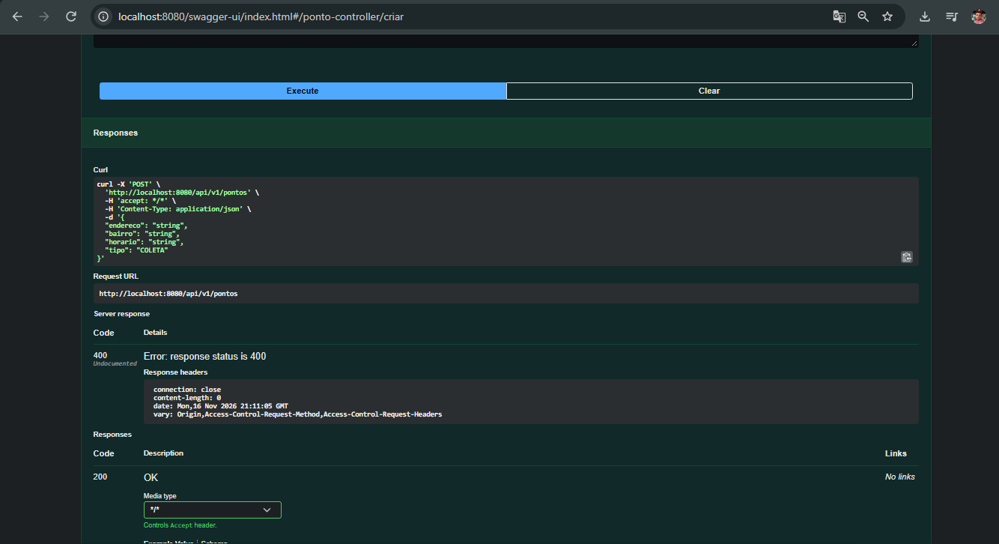

- [x] `GET /api/v1/pontos` — `200 OK`:
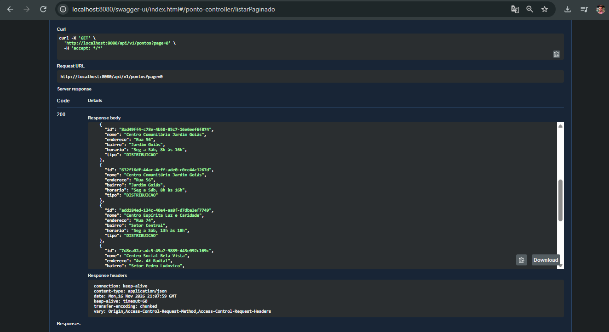

- [x] `GET /api/v1/pontos/{id}` — `200 OK`:
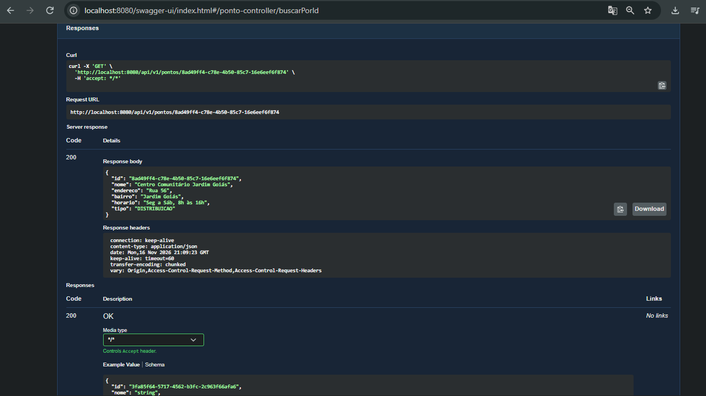

- [x] `PUT /api/v1/pontos/{id}` — `200 OK`:
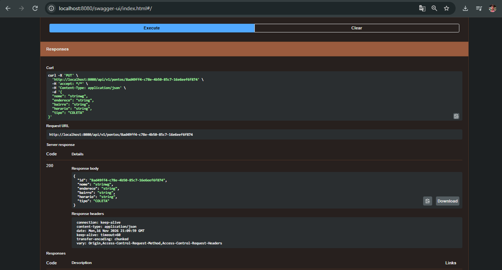

- [x] `DELETE /api/v1/pontos/{id}` — `204 No Content`:
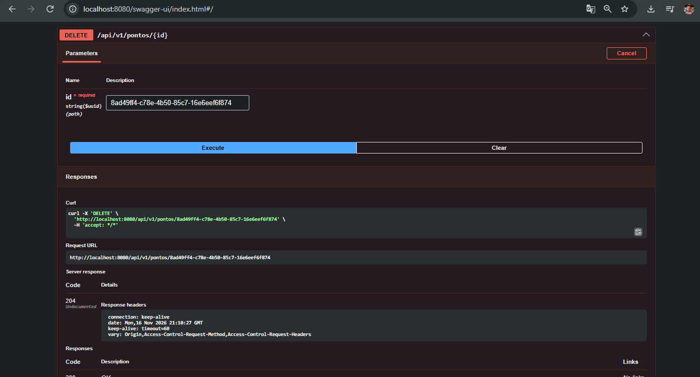

- [x] Validação de campos obrigatórios — `POST`/`PUT` (`400 Bad Request`):


- [x] Recurso inexistente — `GET`/`PUT` (`404 Not Found`):
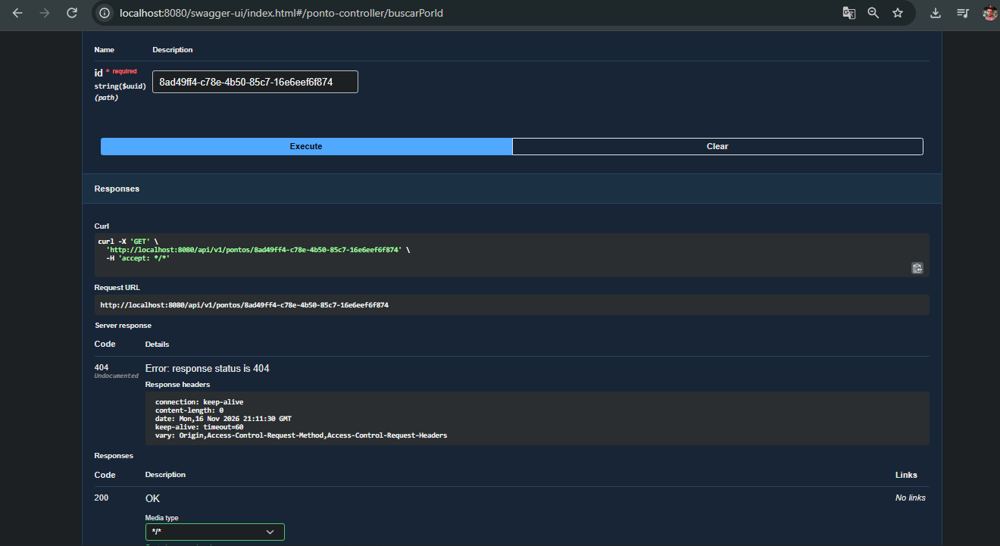


### Paginação e Busca de Pontos ([N2-2])

#### 1. Chamada sem filtro — primeira página padrão, ordenada por nome

**Requisição:**

```http
GET http://localhost:8080/api/v1/pontos/filtro?page=0&size=10
```

**Resposta:** `200 OK`


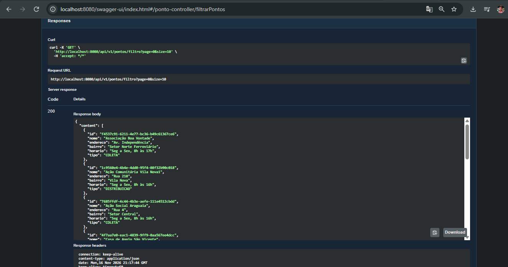


#### 2. Chamada filtrando por bairro — Setor Bueno

**Requisição:**

```http
GET http://localhost:8080/api/v1/pontos/filtro?filtro=Bueno&page=0&size=10
```

**Resposta:** `200 OK`

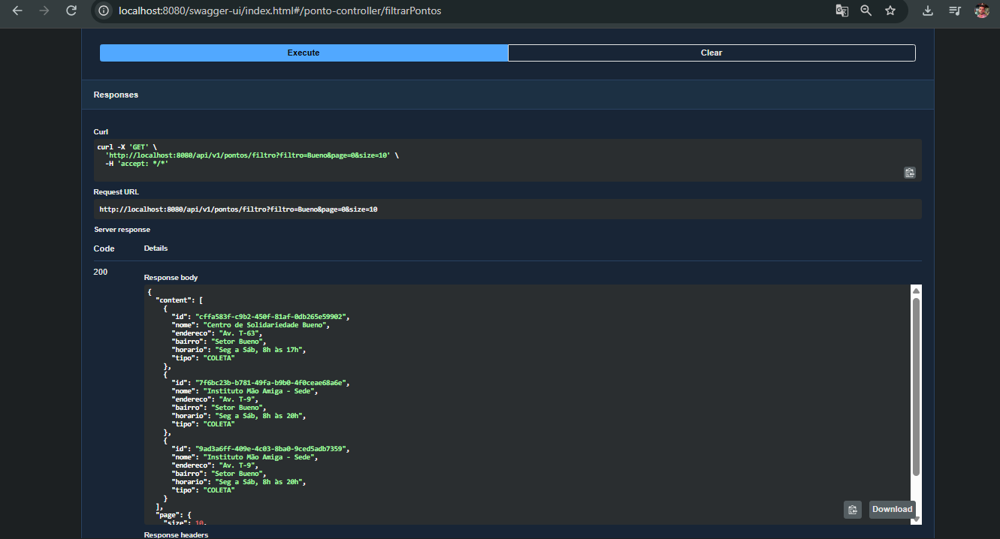


#### 3. Chamada solicitando a segunda página (`page=1`)

**Requisição:**

```http
GET http://localhost:8080/api/v1/pontos/filtro?page=1&size=10
```

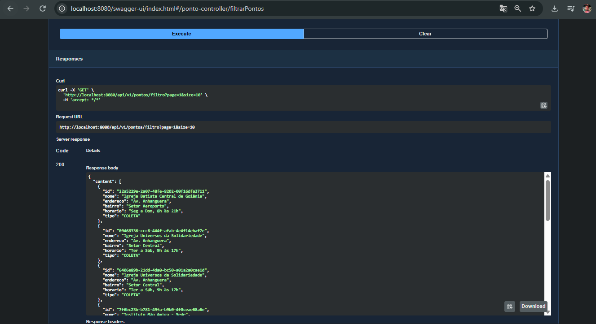


### Módulo 2 — Doações

**Base:** `/api/v1/doacoes`

| Método | Endpoint | Descrição | Status esperado |
|---|---|---|---|
| `GET` | `/api/v1/doacoes/filtro?filtro=&page=0&size=10` | Lista doações de forma paginada, ordenadas da mais recente para a mais antiga (`criadoEm,desc`). | `200 OK` |
| `GET` | `/api/v1/doacoes/{id}` | Busca uma doação específica pelo UUID. | `200 OK` / `404 Not Found` |
| `POST` | `/api/v1/doacoes` | Registra uma nova doação (gera `criadoEm` no servidor). | `201 Created` / `400 Bad Request` |
| `PUT` | `/api/v1/doacoes/{id}` | Atualiza uma doação mantendo `id` e `criadoEm` originais. | `200 OK` / `400 Bad Request` / `404 Not Found` |
| `DELETE` | `/api/v1/doacoes/{id}` | Exclui uma doação pelo UUID. | `204 No Content` / `404 Not Found` |

#### Prints do Swagger — Doações ([N2-5])

Evidências a inserir:

- [x] `POST /api/v1/doacoes` — `201 Created`:
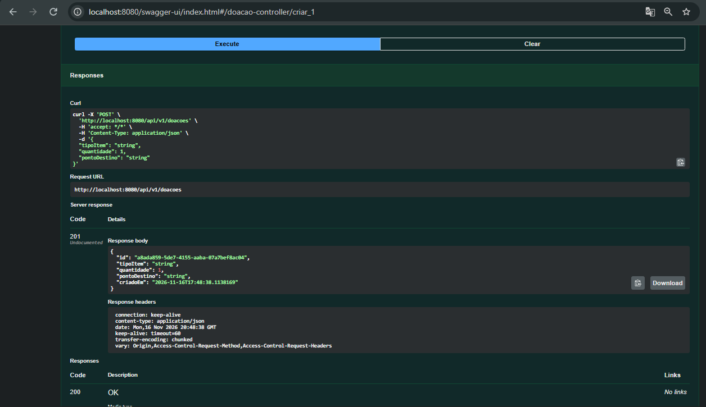

- [x] `GET /api/v1/doacoes/filtro` — `200 OK`:
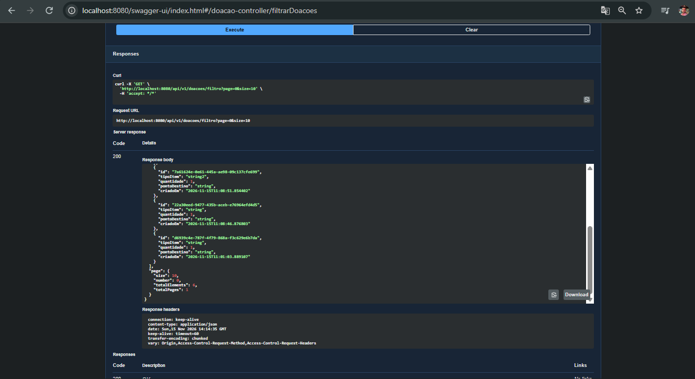

- [x] `GET /api/v1/doacoes/{id}` — `200 OK`:
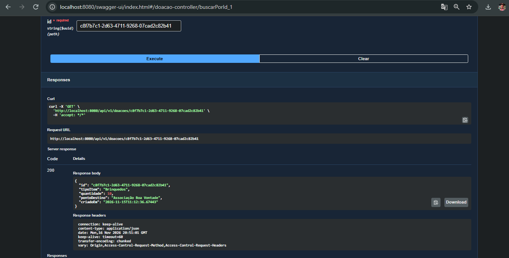

- [x] `PUT /api/v1/doacoes/{id}` — `200 OK`:
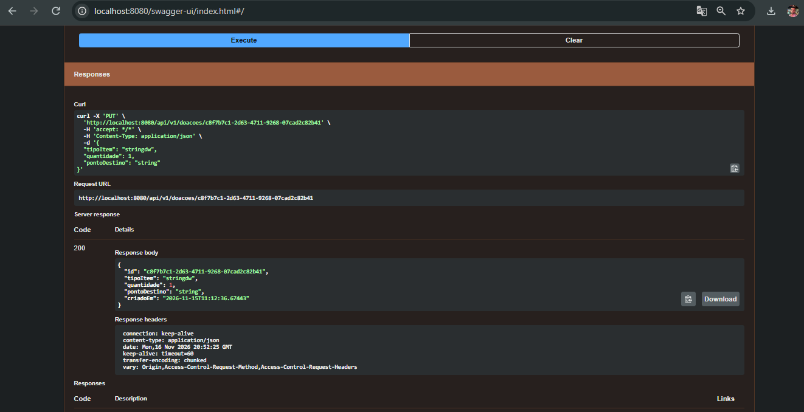

- [x] `DELETE /api/v1/doacoes/{id}` — `204 No Content`:
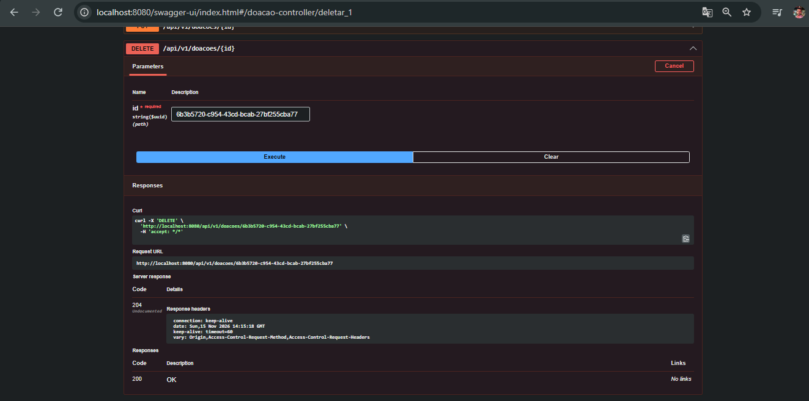

- [x] Validação de regra de negócio — quantidade menor ou igual a zero ou tipo vazio (`400 Bad Request`):
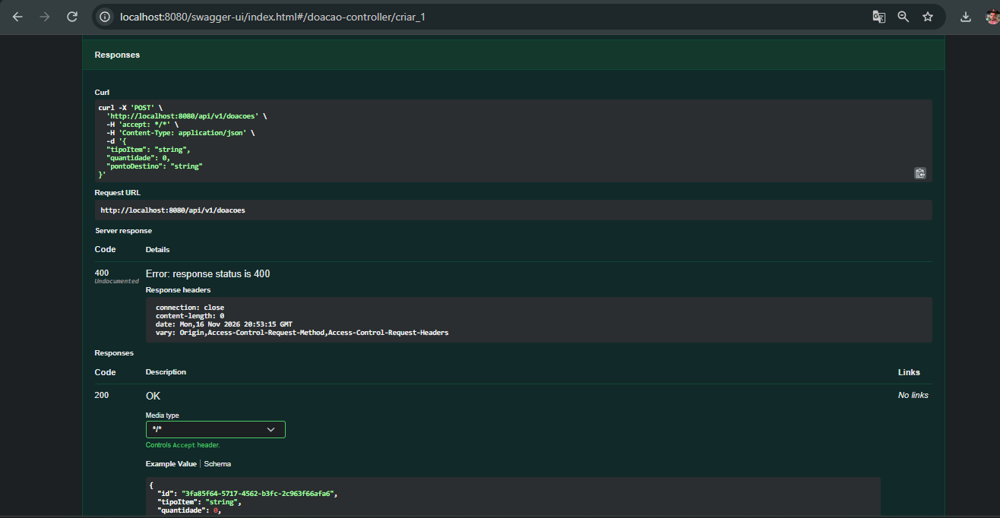

- [x] Recurso inexistente — `GET`/`PUT` (`404 Not Found`):
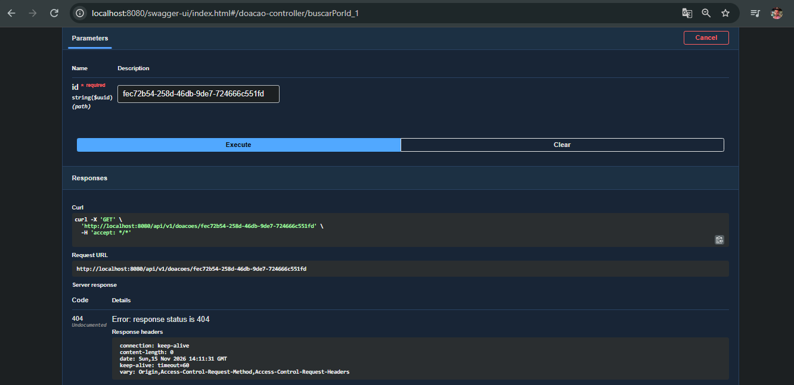

---

## Roteiro de Demonstração (Até 3 Minutos)

### [0:00–0:50] CRUD de Pontos no App

1. Na tela inicial (**Pontos de Coleta**), digitar no campo de busca para filtrar pontos pela API e rolar a lista para demonstrar a paginação infinita.
2. Tocar em **Cadastrar Novo Ponto**, preencher todos os campos e salvar, evidenciando o novo ponto aparecendo na lista sem reiniciar o app.
3. Abrir os detalhes do ponto criado, tocar em **Editar**, alterar o horário e salvar (`PUT`).
4. Abrir novamente os detalhes e tocar em **Excluir** (`DELETE` com confirmação).

### [0:50–1:30] Pontos Favoritos (AsyncStorage + API)

1. Na lista principal, tocar no ícone de coração (`♡` → `♥`) de dois pontos.
2. Acessar **Meus Pontos** no cabeçalho e demonstrar a hidratação dos dados via API a partir dos IDs salvos localmente.
3. Desmarcar um ponto diretamente na tela **Meus Pontos** e demonstrar a remoção instantânea.

### [1:30–2:20] CRUD de Doações no App

1. Acessar **Doações**, tocar em `+` e cadastrar uma doação escolhendo um ponto vindo diretamente da API.
2. Verificar a nova doação no topo do histórico (`criadoEm` gerado no servidor).
3. Abrir os detalhes da doação, editar a quantidade (`PUT`) e depois excluí-la (`DELETE`).

### [2:20–3:00] Validação e Erros na API (Swagger UI)

1. No Swagger, disparar `POST /api/v1/doacoes` com `quantidade: 0` para demonstrar o retorno `400 Bad Request`.
2. Disparar `GET /api/v1/pontos/{uuid-inexistente}` para demonstrar o retorno `404 Not Found`.

---

## Decisão Técnica e Arquitetural

### Por que os favoritos permanecem no aparelho (`AsyncStorage`) enquanto Pontos e Doações residem no servidor (Spring Boot + H2)?

#### Dados transacionais e compartilhados (Server-State)

Pontos de coleta e registros de doações possuem valor institucional, exigem integridade referencial, auditoria temporal (`criadoEm` imutável gerado pelo servidor) e precisam ser compartilhados entre todos os usuários da plataforma. Por isso, residem no banco de dados centralizado, protegidos por regras de negócio e Bean Validation.

#### Preferências locais sem autenticação (Client-State / Local-First)

O escopo do sistema não contempla login ou gestão de identidade de usuários. Persistir favoritos anônimos no banco de dados relacional exigiria criar sessões artificiais no servidor, gerando custo desnecessário de escrita em disco (IOPS) e poluição de tabelas sem valor transacional.

Manter apenas os UUIDs favoritados no `AsyncStorage` do dispositivo garante latência zero na interação visual, funcionamento offline de preferências e resiliência na tela **Meus Pontos** (onde IDs de pontos eventualmente excluídos no servidor são tratados via `Promise.allSettled` e auto-higienizados localmente sem quebrar a interface).
